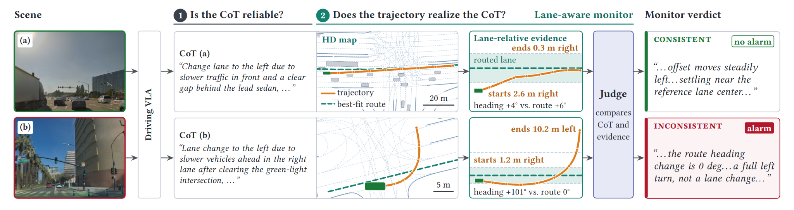

# Drive the Thoughts Artifact

This repository implements the paper "Drive the Thoughts: Runtime Monitoring
of VLA Reasoning-Trajectory Consistency".

<figure>
  
  <figcaption>Using a driving VLA's reasoning as a runtime specification. At each planning step, the VLA emits a chain-of-thought (CoT) and a trajectory. We manually assess CoT reliability (check 1), then monitor whether the trajectory performs the stated maneuver (check 2). A curve can look like a lane change in raw coordinates, so our lane-aware monitor measures the trajectory against the map lane it best follows. It accepts (a), the stated lane change, and flags (b), a left turn into the curb.</figcaption>
</figure>

## Overview

Driving vision-language-action (VLA) models such as NVIDIA's Alpamayo 1.5
produce a chain-of-thought (CoT) that explains each planned trajectory. The
paper asks whether that CoT can serve as a runtime specification: a monitor
checks whether the trajectory performs the maneuver the CoT states. In
DriveAlignBench, 33.3% of CoTs are unreliable, and among reliable CoTs the
trajectory is inconsistent with the CoT in 26% of cases. Giving the judge
lane-relative evidence (the lane-aware monitor) raises F1 from 0.56–0.62 to
0.65–0.82 across four judges.

| What | Where |
|---|---|
| **DriveAlignBench**: 150 CoT–trajectory pairs from Alpamayo 1.5 driving in the AlpaSim simulator, annotated for CoT reliability, CoT–trajectory consistency and trajectory safety (100 reliable) | `data/benchmark/benchmark.json`, media in `data/media/` |
| **Challenge set**: 15 adjudicated unsafe steps from out-of-distribution hazard scenes | `data/benchmark/ood_hazard_2604_unsafe_traces_adjudicated.json` |
| **Monitors**: rule-based, ego-frame (raw waypoints) and lane-aware; the last two are scored by a judge model | `src/`, online version in `alpasim/` |
| **Safety baselines**: SelfOracle (SAE/VAE) and Time Headway | `baselines/` |
| **Per-run results**: 4 judges × 2 monitors × 3 repeats, plus the rule-based monitor, both baselines, latency and temporal aggregation | `data/results/`; `tools/reproduce_paper_tables.py` rebuilds every table |

## Layout

- `data/benchmark/benchmark.json` — DriveAlignBench: 150 CoT–trajectory
  pairs, 100 in the reliable subset, with artifact-relative media paths.
- `data/benchmark/ood_hazard_2604_unsafe_traces_adjudicated.json` — the
  challenge set: 15 adjudicated unsafe closed-loop steps (the 19-step set
  before adjudication sits beside it).
- `data/results/` — per-run results behind every table in the paper: the four
  judges with both monitors (3 repeats each), the rule-based monitor, both
  safety baselines, the challenge set, latency and temporal aggregation. See
  its [README](data/results/README.md) for the table-to-file map;
  `tools/reproduce_paper_tables.py` recomputes the tables from it.
- `data/results/rollout_monitoring/` — closed-loop online-monitoring results
  over 79 rollouts, not reported in the paper: per-step rule-monitor flags
  joined with simulated safety outcomes. See its README for provenance caveats.
- `data/media/` — rollout videos and per-clip scene directories (metadata,
  trajectory geometry, `additional_info.json`, camera frame) for the
  benchmark and the challenge set.
- `src/` — the monitor implementation, installed as packages.
- `tools/` — analysis and plotting CLIs, the vLLM serve script, and Slurm
  helpers.
- `tests/` — unit tests (`uv run pytest`).
- `baselines/time_headway/` — the Time Headway safety baseline: the monitor,
  its log replay, and the scorer for its RQ4 row (per-target results under
  `data/results/time_headway/`). See its [README](baselines/time_headway/README.md).
- `docs/ANNOTATION.md` — building viewer, annotation and review pages for the
  benchmark and the challenge set, with a demo on the annotator starter kit.
- `baselines/selforacle/` — isolated SAE/VAE training, nominal-data calibration,
  and camera-stream anomaly scoring. See the [SelfOracle setup](baselines/selforacle/README.md)
  for its separate CPU/GPU environment and scene-disjoint dataset workflow.
- `alpasim/` — pinned AlpaSim workspace with its own `pyproject.toml` and
  `uv.lock`. Large generated data, models, and rollouts are omitted.

## Setup

```bash
uv sync --frozen
```

Two optional extras: `--extra llm` adds the `openai` client for LLM judge
reruns (or prefix one-off commands with `uv run --extra llm`), and
`--extra xlsx` adds `openpyxl` for spreadsheet output.

## Quick Checks

```bash
# Every table in the paper, recomputed from data/results (about 2 s)
uv run python tools/reproduce_paper_tables.py

# Lane-aware monitor (Opus 5.5, Table 1 run) vs. human labels on the reliable subset
uv run python tools/check_consistency_accuracy.py \
  --consistency-file data/results/llm_matrix/opus.f_llm_map_graph.run_001.json \
  --benchmark-file data/benchmark/benchmark.json \
  --reliable-only

# Time Headway safety baseline: its RQ4 row from the released per-target results
uv run python baselines/time_headway/score.py

# Unit tests
uv run pytest
```

## Viewing and Annotating

`tools/build_benchmark_viewer.py` builds viewer, annotation and review pages
for the benchmark, the challenge set, or any example set, and
`tools/build_frame_selector.py` picks new decision frames from rollout videos
to feed them. See the [annotation guide](docs/ANNOTATION.md) for a demo and
the commands, and the [frame selection tutorial](docs/FRAME_SELECTION_TUTORIAL.md)
for choosing frames.

## Recomputing Monitor Outputs

The temporal aggregation table recomputes from the released verdicts
(`uv run python tools/reproduce_paper_tables.py temporal`). Rerunning it from
rollouts needs the original rollout workspace; see the
[temporal evaluation workflow](docs/TEMPORAL_CONSISTENCY.md).

The rule monitor runs fully offline and reproduces the released verdicts:

```bash
uv run python -m cot_analysis.consistency_check \
  --benchmark_json data/benchmark/benchmark.json \
  --output benchmark.rule_consistency.json
```

The ego-frame monitor is `--variant llm` and the lane-aware monitor is
`--variant center_of_lane` (`f_llm_map_graph` in result file names). The
paper's four judges ran as follows:

| Judge | How |
|---|---|
| Qwen3.5-4B | `--provider qwen35_4b_fp8_thinking_recommended`, your own vLLM server (no key; see below) |
| DeepSeek V4.1 Flash | `--provider deepseek_openrouter`, OpenRouter pinned to DeepSeek (key: `OPENROUTER_API_KEY`) |
| Opus 5.5 | `uv run --extra llm python tools/run_openrouter_batch.py --provider claude_opus_openrouter ...`, OpenRouter Batch API |
| Jev 1.14 | `uv run --extra llm python -m tools.run_jev_decisions ...`, OpenRouter decisions API (Jev has no chat endpoint) |

Each tool's `--help` lists its options. The OpenRouter routes need an account
that allows the provider's data policy.

Pass keys with `--api_key`, the per-provider `--*-api-key` flags on the matrix
runner, the environment, or a `.env` file. Any other OpenAI-compatible host
works through `--base_url` and `--model` — no code changes. Without a key the
judge runs dry and still verifies the trajectory feature pipeline:

```bash
uv run python -m cot_analysis \
  --benchmark_json data/benchmark/benchmark.json \
  --variant center_of_lane --skip-unreliable-cot \
  --output cot_dry.json
```

### Example: the Qwen matrix, end to end

`tools/run_benchmark_llm_matrix.py` runs the provider/variant matrix and
writes repeated runs, logs, and a manifest to `runs/llm_matrix/`.

```bash
# 1. Get a GPU node (Slurm example — we used one A100 80GB; adjust the
#    account/partition/constraint to your site).
salloc -A your_hpc_account -p gpu --gres=gpu:1 -c 8 --mem=64G -t 4:00:00

# 2. Serve Qwen3.5-4B-FP8 behind an OpenAI-compatible API on localhost:8000,
#    with the reasoning parser the thinking-mode provider needs.
tools/serve_qwen_vllm.sh qwen35 setup    # first time only: installs vLLM
tools/serve_qwen_vllm.sh qwen35 serve --gpu-memory-utilization 0.80 \
  --reasoning-parser qwen3               # keep running (own terminal or &)
curl -sf http://localhost:8000/v1/models # ready once this responds

# 3. One repeat of both monitors on all 150 pairs, with the paper's settings
#    (thinking mode, recommended sampling). Repeat k used seed 41+k.
uv run --extra llm python tools/run_benchmark_llm_matrix.py \
  --benchmark-json data/benchmark/benchmark.json --include-unreliable-cot \
  --providers qwen --provider-override qwen=qwen35_4b_fp8_thinking_recommended \
  -n 1 --seed 42 --delay 0 --jobs 1 --output-dir runs/qwen_launch1
```

Restart the server between repeats (outputs repeat within one vLLM launch).
Without `--provider-override`, `qwen` uses `qwen35_4b_fp8` (thinking mode at
temperature 0), which is not the paper's setting.
`tools/run_benchmark_llm_matrix_update.slurm.sh` wraps the workflow
(including starting the server) as a batch job.

## AlpaSim Setup

To run the full simulator:

```bash
cd alpasim
source setup_local_env.sh
uv sync --frozen
```

Run simulator commands with `uv run ...` from inside `alpasim/`. The snapshot
preserves the implementation and Apptainer setup but not the upstream
data/model store; the benchmark media lives at the artifact root under
`data/media/`.

To replay the logged decisions of existing rollouts through the rule monitor
and join the per-step flags with the evaluator's simulated safety outcomes
(closed-loop online monitoring, not reported in the paper; no GPU or
re-simulation needed):

```bash
cd alpasim
PYTHONPATH=src/tools uv run --project src/tools python -m rollout_monitoring \
  --rollout_root <dir-with-scene_*/rollouts/**/rollout.asl> \
  --outcome offroad_or_collision_at_fault --horizon_s 4 \
  --output online_monitoring.json
```

Released outputs of this tool ship under `data/results/rollout_monitoring/`
(the rollouts themselves are too large to include).

## Development

When editing monitor code: `src/alpasim_utils` is the source of truth, and
`alpasim/` carries a byte-identical mirror so the simulator workspace stays
standalone. Edit at the root, then run
`uv run python tools/sync_monitor_core.py --fix`. `pytest` fails if the two
trees drift.
